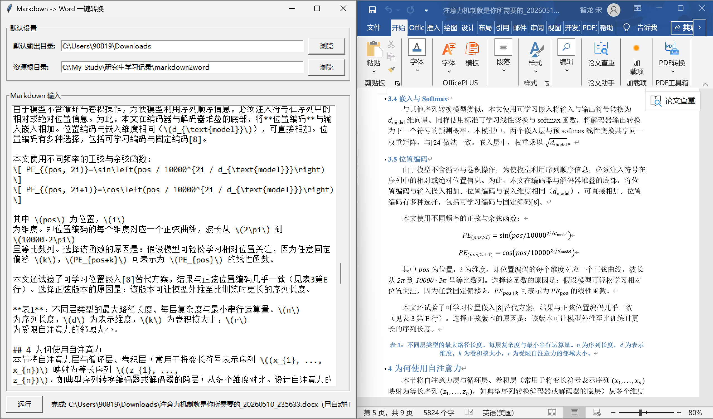

# Markdown2Word

一个基于 Python + Tkinter 的小工具，用于把 Markdown 文本快速转换为 Word 文档（`.docx`）。

项目提供了简单的图形界面，适合将ai的markdown格式的回答整理为word笔记、将ai翻译的论文转化为word文档等场景。当前实现重点放在中文文档排版、公式转换、图片与超链接处理，以及更符合中文写作习惯的段落输出效果。

**可直接双击./markdown2word 文件夹下的 exe 程序运行本程序，简单快捷**

## GUI 效果



## 目前支持

- 图形界面直接粘贴 Markdown 并导出 Word
- 标题、普通段落、粗体、斜体、下划线、代码块
- 表格、图片、超链接
- 普通 Markdown 链接指向可嵌入的图片时会自动插图，支持本地路径和无扩展名的网络图片；网页或无法嵌入的目标保留为超链接
- 兼容复制链接标题中的 `\[...\]` 和地址中的 `\&`。网络图片返回 HTTP 404 时，响应中可读取的图片数据仍可嵌入
- 正文和链接文字中的邮箱转义 `\@` 自动显示为 `@`，代码中的原样文本及显式转义的反斜杠予以保留
- 行内公式与独占一行公式
  - 行内支持 `$...$`、`\(...\)` 和双反斜杠写法 `\\(...\\)`
  - 块公式支持 `$$...$$`、`\[...\]` 和双反斜杠写法 `\\[...\\]`
  - 双反斜杠边界中的转义 LaTeX 命令与花括号会自动兼容，保留标准矩阵、对齐和分段公式中的 `\\` 换行；代码块和行内代码不参与公式转换
  - 支持方框内的分段公式：大括号自动拉伸，单列分段内容左对齐；兼容混合转义的 `\\\\[4pt]` 换行，不产生多余空行
  - 兼容多层转义的公式边界，以及复制文本中的下标、星号转义；保留公式文字命令中的字面下划线和代码内容
  - 复制公式中的 `\_n`、`\_0`、`\_\alpha` 等无花括号下标也会恢复为真正的数学下标
  - `\binom`、`\dbinom`、`\tbinom` 的括号会随组合数的上下两项自动拉伸，也支持嵌套组合数
  - `\tilde`、`\widetilde`、`\hat`、`\widehat` 使用 Word 原生数学重音，避免符号与变量上下分离
  - 求和项支持以负号、正号等符号开头，保留括号内的加减运算，避免出现空求和占位框
  - `\operatorname{SmoothL1}` 等带数字的函数名保持正体显示，并可作为完整求和项；兼容星号及 `withlimits` 写法
  - 矩阵后的尺寸下标、转置上标及上下标组合均作用于整个矩阵，保留完整的可伸缩括号，支持嵌套矩阵
  - 兼容矩阵复制文本中普通变量、数字前多出的换行反斜杠，保留换行后的合法 LaTeX 命令、文本内容及原生矩阵空行
  - 兼容范数双竖线在括号命令后的额外转义，保留可伸缩的双竖线和整体下标，不改动矩阵换行或文字中的字面反斜杠
  - 行内求和按实际写出的上下限显示侧边上下标，省去缺失一侧的空框。兼容复制的行内范数中的双竖线转义
  - 短变量的 `\underbrace` 下花括号适当加宽，单位或说明文字居中对齐
  - 独立公式的分子、分母中可用 `\displaystyle` 将求和上下限置于求和号正上方和正下方，保留完整求和项
- 独占一行的公式会单独成段并居中显示且不首行缩进
- 块公式居中显示
- 带编号的块公式使用 Word 原生显示公式编号结构，编号右对齐，求和等大运算符的上下限保持在符号上下方；行内公式及显式 `\nolimits` 保留侧边上下标
- 正文可在 GUI 中选择首行缩进 2 字符或顶格
- 显式 HTML 对齐优先于正文缩进选项：独立的 `<div align="center">` 内段落无缩进居中，`<div align="left">` 内段落无缩进且保持两端对齐；支持转义的 `\<div>`、内部 Markdown 和嵌套对齐，容器外正文继续使用全局设置
- 一级标题居中显示
- 单独一行的“摘要”居中显示
- 独占一行的图片居中显示且不首行缩进
- 正文中连续独占一段的图片自动紧凑排版，每行两至三张。三张图中首图接近方形且后两张较宽时，排成左侧主图、右侧上下两图。图片保留原比例，正文或题注会分隔图片组
- 识别连续的论文缩略图、单独加粗的标题和作者等信息列表，导出为左图右文的论文卡片
- 导出时过滤可识别的网页 favicon，并清除紧跟的「来源名称+数量」行
- 题注识别与居中
  - 例如 `表3：XXX`、`图2：XXX`、`Table 1: XXX`、`表1 XXX`、`表1. XXX`
- 有序列表按原文重新从 `1.` 开始
- 转换完成后自动尝试打开生成的 Word 文档（Windows / macOS / Linux 图形界面）
- SVG 图片会通过 `cairosvg` 自动转换为 PNG 后插入；如果转换失败，可以先手动把 SVG 转成 PNG/JPG
- 如果希望转换完成后自动打开文档
  - macOS 需要系统自带 `open`
  - Linux 需要桌面环境和 `xdg-open`
- setting.json中的
  - output_dir（输出目录），默认输出目录优先取用户的 Downloads，如果没有就尝试 下载，再不行就退回到用户主目录
  - asset_root（资源根目录），默认为当前工作目录，也就是你从哪里启动程序，默认资源根目录就指向哪里
  - title_chars（导出文件名截取的标题长度），默认是 12
  - body_first_line_indent（正文首行是否缩进），默认是 True
  - markdown_word_wrap（Markdown 输入框是否自动换行），默认是 False
- GUI 顶部可填写保存文件名，可填 `xxx` 或 `xxx.docx`；不填则继续按 `title_chars` 自动生成
- 遇到同名文件时自动保存为 `xxx(1).docx`、`xxx(2).docx`
- `Ctrl+S` 可直接运行并生成 Word
- Markdown 输入框支持自动换行开关，关闭后显示横向滚动条
- Markdown 输入框支持 `Ctrl+Z` 撤销、`Ctrl+Y` 重做
- `Ctrl+F` 打开查找栏，不区分大小写并高亮匹配；查找栏中按 `Enter` / `Shift+Enter` 跳到下一个 / 上一个，首尾循环，`Esc` 关闭并返回输入框

## 后续调优历程

  - 2026年5月11日——添加正文首行缩进开关、修改了列表中字体无法加粗显示的bug、优化了列表的缩进美观、完善对exe程序的读取配置规则
  - 2026年5月18日——针对豆包给的文本存在
    ```text
    ## 图1：实验结果对比
    我们的方法……
    ```
    识别为二级标题+文本而不能正确识别为图表标题的情况，代码添加了预处理阶段，将其合并为一个普通段落，再走 Caption 样式识别
  - 2026年5月24日——补充跨平台运行支持，生成完成后会按系统分别调用 Windows 默认打开方式、macOS `open` 或 Linux `xdg-open`
  - 2026年5月30日——图片插入格式居中、标题摘要居中、SVG 图片插入、资源根目录支持与markdown中的相对路径进行拼接再寻找图片等资源（适合存在多个资源目录的情况）也支持不与markdown中的相对路径进行拼接，直接定位资源根目录下的文件名（适合仅存在单个资源目录的情况）
  - 2026年6月26日——将公式中的 aligned / align / split 转成 Word OMML 矩阵，多列公式会对齐，支持markdown的>块引用格式，支持URL图片的插入
  - 2026年6月28日——对于带编号的公式支持编号右对齐，同时公式居中显示；支持 word 多种样式的初始化；支持（嵌套）无序列表、完成/待办、--- 水平线；优化∑公式的渲染；设置纸张大小为A4纸；一行多公式\quad正确显示
  - 2026年7月11日——再次修复一行多公式\quad正确显示；\begin{array}{rl} ... \end{array} \quad (n) 会先转成等号对齐结构，再生成 Word 矩阵列对齐；\dagger 匕首符正确显示为 †；双重求和公式对第一个求和的空操作数补一个不可见的零宽占位字符 U+2060，防止 Word 生成占位框。
  - 2026年8月19日——优化 \underbrace、\overbrace 大括号的生成效果
  - 2026年8月29日——没有空行分隔的内容解析成同一个 &lt;p&gt; ,按整个 &lt;p&gt; 判断样式变为简单文本段落的按行渲染逻辑
  - 2026年9月15日——GUI 顶部增加保存文件名输入框，运行按钮移到顶部，支持 Ctrl+S 运行；正文首行缩进改为“缩进/顶格”互斥选择；导出文件名取消时间戳，同名文件自动追加序号；题注不加粗；正文和引用块两端对齐；\widehat公式渲染修正
  - 2026年9月16日——Markdown 输入框增加自动换行开关，关闭自动换行时显示横向滚动条
  - 2026年11月10日——兼容双反斜杠公式边界及转义花括号，保留原有公式语法和矩阵换行，增加公式转换回归测试
  - 2026年11月10日——修复方框内分段公式的大括号、左对齐及混合转义换行产生空占位框的问题
  - 2026年11月15日——兼容多层转义的整段 Markdown 及公式下标、星号，修复波浪号重音，并增加 4D 高斯泼溅整段转换回归测试
  - 2026年11月15日——Markdown 输入框增加撤销、重做和不区分大小写的查找高亮，支持快捷键跳转及关闭查找栏
  - 2026年11月17日——补全复制公式中单字符、数字和命令形式的下标转义处理，修复下降阶乘 `[x]_n` 的显示
  - 2026年11月17日——将组合数的普通括号修正为 Word 可伸缩括号，兼容行内、块公式及嵌套组合数
  - 2026年11月19日——修复带编号公式被 Word 当作行内公式的问题，保留双重求和的上下限位置及分式大小，编号继续右对齐
  - 2026年11月19日——区分求和项的一元正负号与项间加减号，修复方框内双重求和出现空占位框、负号及括号内表达式脱离求和的问题
  - 2026年11月19日——兼容 `\operatorname` 中的数字，修复 SmoothL1 等函数前的空求和占位框及函数名斜体问题
  - 2026年11月21日——修复复制的邮箱地址中 `\@` 残留反斜杠的问题，保留代码、公式及成对反斜杠的原有处理
  - 2026年11月22日——完善 HTML 对齐容器及转义副本的解析，修复段落对齐继承和缩进优先级，保留正文两端对齐与公式排版
  - 2026年11月22日——修复矩阵带上下标时括号、矩阵内容与尺寸下标错位或丢失的问题，兼容行内、块公式及多种矩阵括号
  - 2026年11月23日——修复复制的矩阵换行后变量、数字前残留反斜杠的问题，兼容嵌套矩阵及 aligned 投影计算，保留合法命令与文字内容
  - 2026年11月23日——根据是否带参数区分矩阵行末的 v、u 等普通变量与单字母重音命令，修复投影向量中残留反斜杠的情况
  - 2026年11月25日——修复复制的范数双竖线残留反斜杠、范数下标脱离整体的问题，兼容多层转义、矩阵范数及原有公式
  - 2026年11月25日（`a34c7e5`）——修复行内求和只写上限或下限时另一侧出现空框的问题，并还原复制的行内范数双竖线
  - 2026年11月25日（`1a29874`）——给 `\underbrace` 中的短变量添加对称留白，使下花括号舒展，单位标注保持居中
  - 2026年11月25日（`b555cc3`）——普通 Markdown 链接指向可读取的本地或网络图片时自动嵌入 Word，支持无扩展名的图片 URL，网页链接继续可点击
  - 2026年11月25日（`8a29ffd`）——修复分式内 `\displaystyle` 求和项脱离求和号并产生空框的问题，求和上下限分别置于正上方和正下方
  - 2026年11月25日（`6225a8b`）——修复复制链接标题中的转义方括号被误识别为公式、URL 查询参数中的 `\&` 未还原的问题，兼容带有效图片数据的 HTTP 404 响应
  - 2026年11月26日（`fc62333`）——连续图片自动按比例紧凑排版，支持两到三张并排和左一右二布局
  - 2026年11月27日（`538fb70`）——将论文缩略图、标题和信息列表排成左图右文的卡片，导出时移除可识别的网页图标及紧邻的来源计数行


## 适用场景

- 将 Markdown 笔记快速整理成 Word 文档
- 将ai帮忙完成的课程作业、实验报告、论文翻译稿从 Markdown 导出为 `.docx`
- 将ai回答的有用知识从 Markdown 导出为 `.docx`，方便整理笔记
- 将包含公式、图片、表格的中文技术文档转换为可继续编辑的 Word 文件

## 环境要求


### 双击运行

- 带图形界面的 Windows、macOS 或 Linux 环境
- 电脑安装 Microsoft Office 并设为`.docx`的默认打开软件（wps打开的话公式阅读正常但可能复制粘贴格式会出问题）

### 源码运行
- Python 3.10 及以上版本
- 推荐使用 conda 环境运行，Tkinter、Cairo 等底层依赖统一由 conda 管理
- 电脑安装 Microsoft Office 并设为`.docx`的默认打开软件（wps打开的话公式阅读正常但可能复制粘贴格式会出问题）


## 运行方式

### 双击 markdown2word.exe 程序运行

./markdown2word 文件夹下有已经打包好的 exe 程序，直接双击运行已经打包好的程序，无需配置python环境。这种方式最简单直接，同时可鼠标右键创建快捷方式放到桌面供以后使用，方便快捷。

### 使用 base 环境（方便简单项目管理）

如果只是自己电脑上长期使用，可以直接在 conda 的 `base` 环境里安装依赖并运行：

```bash
conda activate base
conda install -c conda-forge tk cairosvg cairo
pip install -r requirements.txt
python markdown2word.py
```

这种方式步骤更少，适合简单项目的统筹 base 管理，但会把本项目依赖安装到 `base` 环境中。如果希望环境更干净，建议使用下面的专用环境方式。

### 新建环境（环境更干净）

安装 Anaconda 或 Miniconda 后，在项目目录打开终端，执行：

```bash
conda create -n markdown2word python=3.10 pip tk cairosvg cairo -c conda-forge
conda activate markdown2word
pip install -r requirements.txt
python markdown2word.py
```

## 项目文件

```text
markdown2word.py          GUI 入口
converter.py              Markdown -> Word 核心逻辑
mml2omml.xsl              公式转换所需 XSLT
settings.json             本地默认配置
data/GUI_and_result.png   GUI 效果截图
data/app_icon.ico         程序图标
```

## 后续可扩展方向

- 支持更多 Markdown 扩展语法
- 支持自定义 Word 模板
- 支持更细致的段落、字体、页边距和标题样式控制
- 支持批量导入 Markdown 文件并自动导出

## 打包指令

### Windows exe

exe程序已经打包并放在 markdown2word 文件夹下

```bash
pyinstaller --noconfirm --clean --windowed --onefile --icon data/app_icon.ico --add-data "mml2omml.xsl;." --collect-data latex2mathml markdown2word.py
```

### macOS / Linux

注意 `--add-data` 的分隔符要改成 `:`，且打包过程需自己运行下述指令完成

```bash
pyinstaller --noconfirm --clean --windowed --onefile --add-data "mml2omml.xsl:." --collect-data latex2mathml markdown2word.py
```
